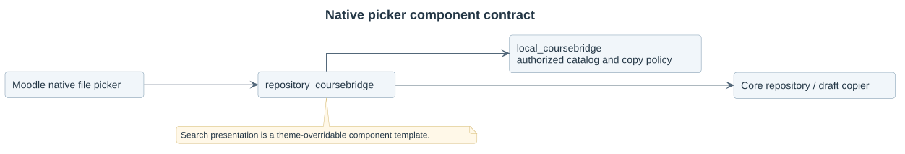

# MultiPicker — repository_multipicker

Materials from related courses inside Moodle's native file picker.

Install at `repository/multipicker`. This plugin requires **local_multipicker** and delegates grouping, access, publication and author policy to it. It owns no business tables or binary store.

## Install and use

Install local_multipicker first, install this package through Moodle's plugin upgrade procedure and enable **Materials from related courses** under Site administration → Plugins → Repositories → Manage repositories.

Press **Import materials** beside a supported native Folder/File filemanager for visual multiple selection inside the picker. Other course editing filepicker controls retain individual selection. Filter by profile, file name, edition, course shortname, source activity and file type. Identical content appears once with its permitted origins. Choose an exact source declaration to copy into the native draft.

The target context comes from the repository instance. System/private-user upload contexts are rejected. The native control retains its allowed file types and size limits.

## Documentation

- [Picker workflow](docs/01-picker-workflow.md).
- [Authorization and draft architecture](docs/02-architecture.md).
- [Installation and exact core targets](docs/03-installation-and-compatibility.md).
- [Theme-overridable search fields](docs/04-presentation-and-theming.md).
- [Source folders and native entry contracts](docs/05-source-structure.md).
- [Native browser acceptance checks](docs/06-native-picker-tests.md).
- [UC01 search](docs/use-cases/uc01-search-materials.md) and [UC02 attach](docs/use-cases/uc02-attach-material.md).
- [UML sources and previews](docs/diagrams/README.md).
- [Development checks](CONTRIBUTING.md).

Version: **alpha**. This maintenance distribution targets Moodle 5.3; Moodle 4.5 uses the separate Moodle 4.5 distribution. Initial source author/licence is preserved; strict copying is refused because later native author edits cannot be prevented by this package. Editable-with-provenance policy allows later native changes.

The native picker supplies the dialog and file presentation; the plugin's search fields use a theme-overridable Mustache template. The local dependency supplies the native chooser AMD adapter; this repository owns no frontend bundle. License: GPL v3 or later.
