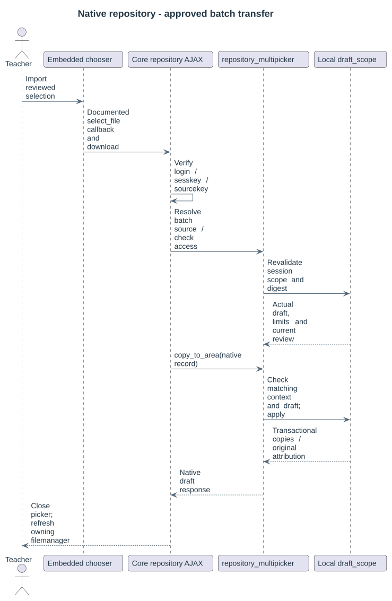

# Native picker workflow

Open native Add files, then select **MultiPicker** with its repository icon. Registered activity filemanagers and editors open a scoped multiple-selection browser inside the existing picker, on both create and edit forms. The separate Folder content Edit page requires only its native managefiles permission plus MultiPicker access.

Source activity initially matches the destination module. Choose All to browse other enabled public areas. Filename typing and filter selects update results automatically; custom named capture filters come from the selected relationship profile. Select file cards or entire Folder content trees, switch Cards/List layout, navigate folders, and keep selections across result pages.

Review selection opens a separate page in the same modal. A collapsible tree shows destination paths, original declarations and decisions. Back returns to selection. Import reviewed materials invokes Moodle's documented external chooser and protected download; the original native form retains saving/cancellation authority. File activities retain their existing main-file choice. Tiny's native Link picker inserts all reviewed links; image/media controls remain single-file.

Supported public areas are declared by the local dependency and enabled by each profile: Folder/File/Page/Book content, Assignment handouts/instructions and public activity introductions. Hidden/restricted/private sources, submissions and feedback are excluded. Explicit publication and ordinary native access follow the local policy; source tokens never grant permission.

## Individual controls

Unregistered native upload controls retain Moodle's ordinary single-file listing/search contract. Its labelled profile, filename, edition, course, source module and type controls use native Search submission. Identical bytes group together; expand a group to choose a concrete authorized occurrence and its original author/licence.

The local plugin resolves author policy for source and destination. Strict locks refuse unsupported later native metadata protection. Editable-with-provenance preserves initial author/licence in history, including when the client submits another author. Integration covers registered native Repository API controls, not arbitrary custom uploaders or backup importers.

Folder choices resolve real descendant file selections. Partial selection is visible on parent folders and children retain their checks while navigating. Review allows changing destination filenames and removing one or several files before a fresh server approval. Only result elements scroll; header/footer stay fixed. This behavior belongs to local_multipicker and the repository transfers the reviewed descriptor through Moodle's native download contract.

The embedded heading uses the actual native repository instance name. Select all includes all matching pages, subject to the native limits. Filters remain enabled and retain their DOM/focus while only results load. Review filenames are plain text; native pencil actions open Save/Cancel rename dialogs.
