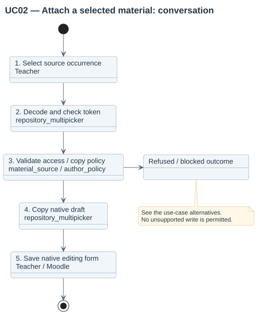

# Native picker workflow

Open a course form's file picker and select **Materials from related courses**. Select the relationship profile, filename query, edition label, exact course shortname, source module or MIME type, then press **Search**. Tab follows the labelled controls in that order and reaches Search; Enter on the button submits through Moodle's native search handler. Results are authorized in the local plugin before they appear.

Identical bytes appear as one grouped result. Expand it to choose a concrete occurrence, its course/module/path and declared author. Selecting it copies a native file into the logged-in user's draft; the destination form retains its own file size/type validation.

Author policy is resolved on the server for source and destination. The current copy implementation rejects strict locks rather than pretending a hidden field prevents native metadata edits. Under editable-with-provenance, the initial source author/license is preserved even if a client submits the importer as author.

Supported source areas are folder/resource content declared by the local plugin. Hidden/restricted/private sources are excluded. This integration applies to controls invoking the Repository API, not every backup/import/custom uploader in Moodle.
