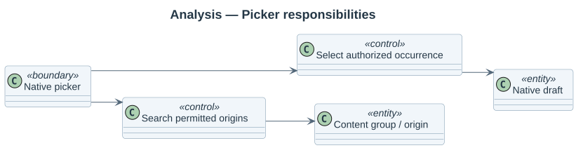
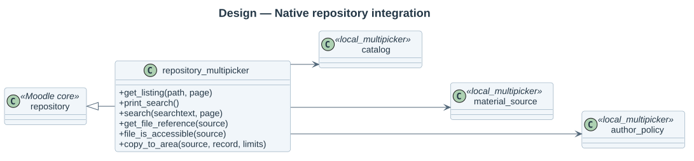
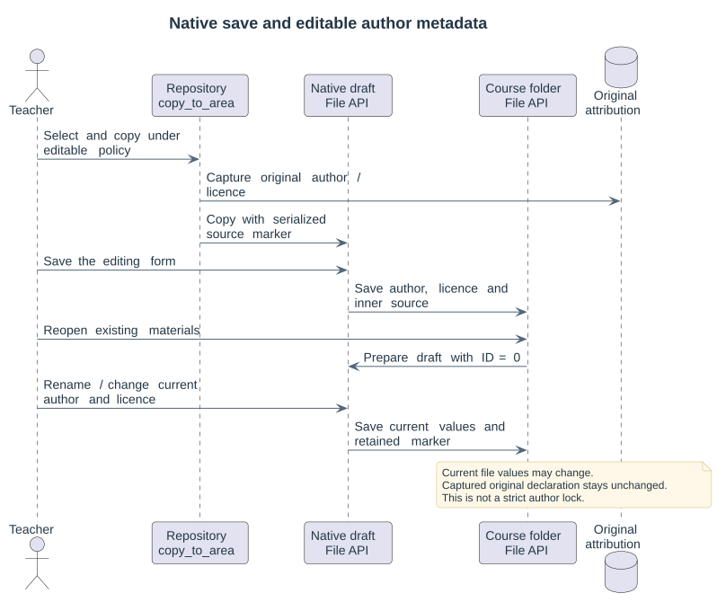

# Repository architecture

repository_multipicker extends Moodle's `repository` class and supports `FILE_INTERNAL`. local_multipicker is its versioned dependency and sole business-data owner. Keep this package focused on UI/native-draft integration.

## Listing and filtering

`get_listing()` decodes navigation state, delegates authorized search to the local catalog, emits one node per content result and exposes matching occurrences in a child listing. A content cursor finishes a grouped hash before moving on, avoiding duplicate cards across pages. `print_search()` uses native HTML fields; `search()` delegates to the same server service.

## Selection and copying

`get_file_reference()` decodes profile/native locator, checks the current target course and source permissions, enforces current author coverage and returns a Moodle packed reference. `file_is_accessible()` uses that check rather than trusting a bare native file locator. Core session/source-key protections remain in place.

`copy_to_area()` revalidates immediately before copying, preserves initial source author/license, captures original attribution and calls the core draft copier. Caller-submitted author values do not override the source declaration. Full later native editor protection is not provided by the repository alone.

Capture and core copy share a delegated database transaction. A core size-limit rejection rolls back the attribution and database file records. Draft source metadata uses Moodle's serialized object with an inner JSON source; native save extracts that source. It retains the attribution UUID after reopening and renaming in the tested editable workflow.

Later native author/licence changes remain possible after an editable-policy copy; the captured original declaration stays unchanged. The source marker is not an authorization token. An effective strict policy refuses MultiPicker copying, including policy changes between selection and copy; it does not retroactively freeze files already copied under an editable policy.

This plugin has no XMLDB installation tables. The Privacy provider declares linked core file/local-plugin ownership. Business-table access is confined to discovery/lookup contracts; copying never manipulates physical content storage.

## Reviewed batch sources

When `get_listing` finds a valid owning-form scope for the current context/itemid and native `filemanager` environment, it returns Moodle's documented `object` HTML chooser description. Requests without that live binding retain individual listings.

A batch descriptor contains the opaque session scope and review digest. `get_file_reference` validates its types, actor/session, context, current review and sources before returning a representative native packed reference. `copy_to_area` checks the exact owning draft again and applies the remembered batch using authoritative limits. The native source-key check remains in core. The returned native file response refreshes the original filemanager, including when every reviewed file is skipped as identical. No permanent activity save occurs here.

