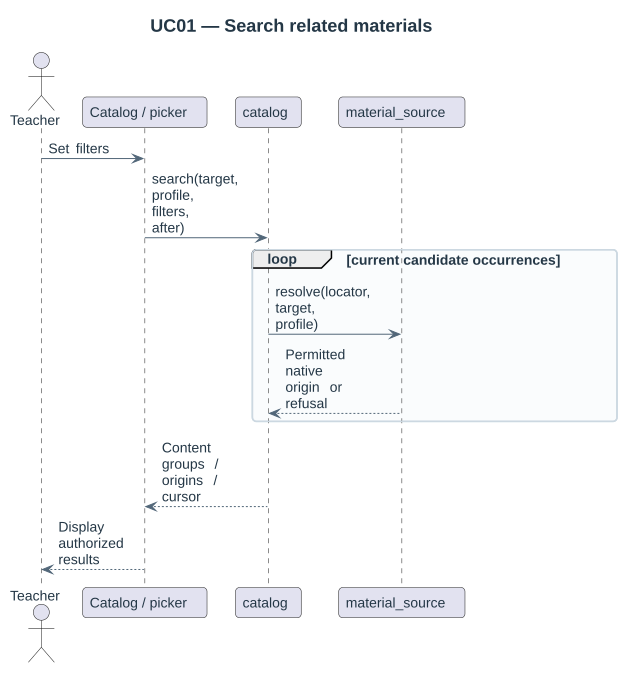

# Native picker acceptance

The packaged [Behat feature](../tests/behat/native_picker.feature) runs inside Moodle's isolated acceptance site with Firefox and Boost. Its fixture uses native courses, modules, enrolment, File APIs and real Repository AJAX. The local dependency supplies the supported filemanager binding and embedded chooser.



The teacher is enrolled only in the destination course. Earlier editions explicitly publish materials; hidden material is excluded. The destination already contains a file. Tests explicitly opt into editable-with-provenance while retaining the strict package default.

| Scenario | Verified behavior |
|---|---|
| Unique content and hidden sources | Filename search presents one lesson file across two editions and excludes hidden activity/files. |
| Combined filters and save | Filename, edition, exact shortname, activity type and MIME filters use the embedded native form; source author is reviewed; native save preserves the existing destination file. |
| Retained selection | A selected source folder remains selected after searching for an individual resource; review expands both. |

The repository feature passes **3 scenarios / 37 steps** on each exact required core. The local dependency's checks cover automatic filters with retained focus, whole-card selection, separate folder-tree review, restricted Folder content permission, public Assignment handouts and Tiny multi-link save/reopen. Administration checks cover guided profiles, native document upload, migration exclusions across searches and native report navigation. Service suites also check undeclared/private areas and unrelated fragment contexts.

The [local validation record](../../moodle-local_multipicker/docs/07-validation-and-decisions.md) gives the exact core/runtime matrix. Desktop/mobile inspection and explicit labels are useful evidence, not a complete accessibility certification.

## Run checks

Use a disposable Moodle checkout with independent Behat database/dataroot/URL, install both packages and initialize from the core checkout root:

```sh
# Moodle 4.5.
php admin/tool/behat/cli/init.php

# Moodle 5.3.
php public/admin/tool/behat/cli/init.php

# Use the configuration path printed by init.php.
php vendor/bin/behat --config /path/to/behat.yml --tags=@repository_multipicker
```

The local dependency provides the shared embedded-browser Behat context. Both component generators are isolated test fixtures, not administration actions. Source resource fixtures remove generated sample files before adding their declared materials.
