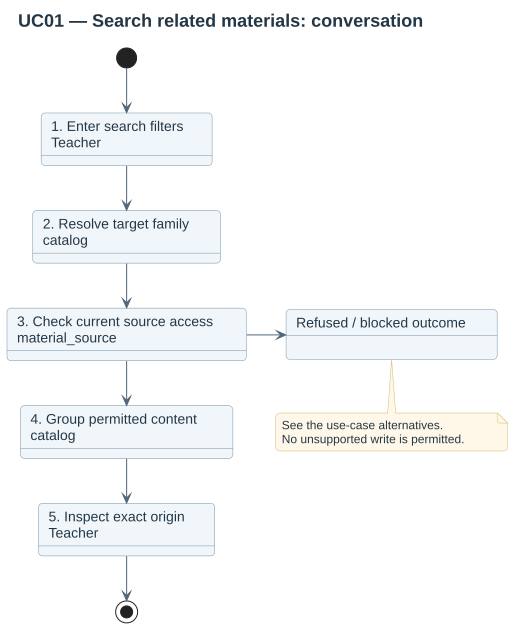

# UC01 — Search related materials

Primary actor: **Teacher**. Find authorized teaching files without duplicate content results.

Precondition: The actor has browse authority in a course editing context and an enabled profile exists.

1. **Teacher:** Opens the catalog or repository and enters filters.
2. **catalog:** Resolves the active profile and target family.
3. **material_source:** Checks current source eligibility and access for matching occurrences.
4. **catalog:** Groups permitted matches by content and completes a cursor page.
5. **Teacher:** Inspects source editions and author declarations.

- Unknown family returns an empty scoped result.
- Hidden, restricted or revoked origins are excluded before grouping.
- Identical bytes retain distinct origin declarations; no canonical author is invented.

Result: A page of permitted content groups and their origins is shown. No course files are written.

[Source inventory](../diagrams/README.md) · [Picker workflow](../01-picker-workflow.md).
