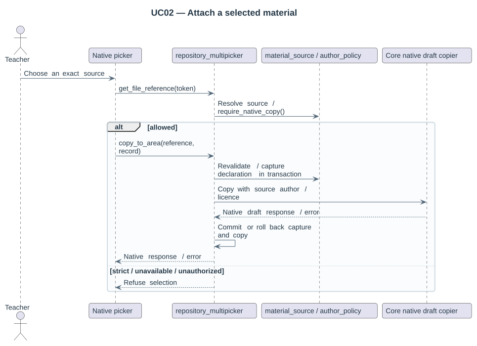

# UC02 — Attach a selected material

Primary actor: **Teacher**. Copy one authorized source occurrence through the native course file picker.

Precondition: The actor can reuse materials and edit the target course; the selected source exists.

1. **Teacher:** Chooses an exact permitted source in the native repository.
2. **repository_multipicker:** Decodes the source token and resolves the target context.
3. **material_source / author_policy:** Revalidates live source access and author-copy policy.
4. **repository_multipicker:** Copies into the native draft with the source author, licence and attribution UUID.
5. **Teacher / Moodle:** Saves the course editing form through its native module contract.

- Malformed, unavailable or unauthorized sources are refused.
- Strict author policy or required missing author blocks copying.
- Native target file-type and size restrictions still apply.

Result: The draft contains the selected material with its initial declaration; native saving owns the resulting course file.

[Source inventory](../diagrams/README.md) · [Picker workflow](../01-picker-workflow.md).
